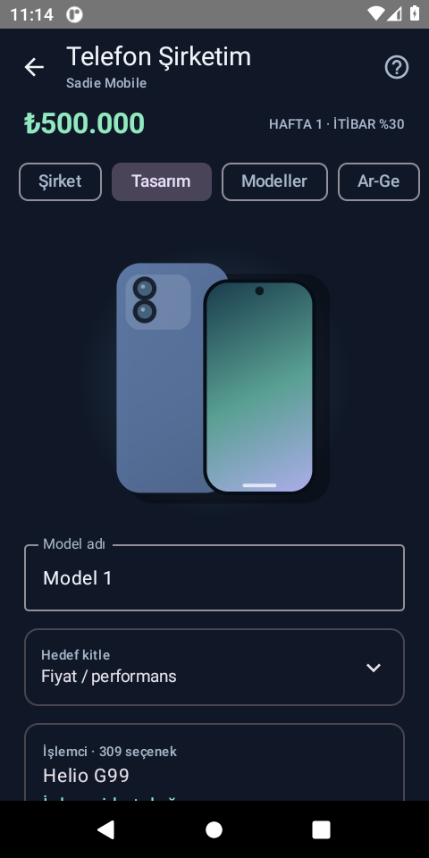

# SadieText — Android özel mesajlaşma

**0.3.0-preview.** Firebase Authentication ve Cloud Firestore ile gerçek bire bir mesajlaşma.

[](https://github.com/nightmare608/SadieText/actions/workflows/android.yml)

Firebase APK başarılı derleme, JVM/lint ve Firestore Emulator testlerinden sonra
[Releases](https://github.com/nightmare608/SadieText/releases) bölümünde **SadieText.apk**
adıyla yayımlanır. Firebase ayarı eksikse derleme durur; demo APK yayımlanmaz.
Önceki `SadieText-Cevrimdisi.apk` gerçek mesajlaşma sürümü değildir.
Gerçek cihaz testleri bu iş akışında çalıştırılmaz.

[Firebase hata tanılaması](docs/FIRESTORE_DIAGNOSTICS.md) ·
[GitHub Firebase derlemesi](docs/FIREBASE_APK.md).

Android 8.0+ için Kotlin / Jetpack Compose / Material 3 uygulaması.
Gerçek Firebase Authentication, Firestore taşıma katmanı ve **libsignal 0.105.1**
ile mesaj şifreleme entegrasyonu içerir. Entegrasyon bağımsız güvenlik denetiminden
geçmemiştir; Signal uygulamasıyla aynı güvence iddia edilmez.

Açılışta “Sadie Sink en iyi oyuncu” yazısı ve ikisi de uygulamaya geçiren
iki “Kabul et” seçeneği bulunur.

## Bu paketten başlama

1. ZIP'i açın, `SadieText/` klasörünü Android Studio'da **Open** ile seçin.
2. **Gradle JDK = 21** seçin. Derleme hedefi JVM 17'dir ancak güncel libsignal'ın
   JVM testleri Java 21 ister. JRE değil, tam JDK kullanın.
3. SDK Manager: Platform **35**, Build Tools **35.0.0**, Platform Tools ve
   **NDK 27.0.12077973** kurun. NDK, Signal yerel kütüphanelerinin hata ayıklama
   sembollerini temizleyerek APK boyutunu küçültmek için kullanılır.
4. Firebase'i aşağıdaki rehbere göre yapılandırın. `app/google-services.json`
   yoksa proje yine derlenir; APK **kurulum ekranı ve yerel arayüz demosuyla** açılır.
5. Gradle Sync yapın. Android 8+ telefon/emülatör seçip **Run app** deyin.

**Firebase projesini yalnızca uygulama sahibi oluşturur.** Arkadaşlarınıza aynı
Firebase projesiyle derlediğiniz APK'yi dağıtırsınız; her kullanıcı Firebase
projesi oluşturmaz. Firebase APK bu ayar dosyasıyla yeniden derlenmelidir.
Kaynak ZIP'e bu dosya eklenmez; yeniden derlerken kendi dosyanızı
`app/google-services.json` konumuna koyun. Canlı servislerin test sonucu
[bağlantı raporunda](docs/FIREBASE_CONNECTION.md) bulunur.

## Gerçek mesajlaşmayı açma

[FIREBASE.md](docs/FIREBASE.md) adımlarını tamamlayın: Spark proje, Email/Password
sağlayıcısı, Firestore, kurallar/indeksler ve yerel Google yapılandırma dosyası.
Dosyayı ekledikten sonra **APK'yi yeniden derlemek gerekir**.

1. İki ayrı hesapla kayıt olun; Gmail adresi de kullanılabilir.
2. İki e-posta adresini doğrulayın, uygulamada **Doğruladım, kontrol et** deyin.
3. Görünen isim ve benzersiz kullanıcı adı belirleyin.
4. Arkadaşın tam kullanıcı adını arayın ve sohbeti açın.
5. İki telefondaki **60 haneli güvenlik numarasını** yüz yüze veya güvendiğiniz
   ayrı bir kanaldan karşılaştırın. Aynıysa iki cihazda da doğrulayın.
6. Bundan sonra yazışabilirsiniz. Firebase'e mesajın düz metni gönderilmez.

İsteğe bağlı Google/OAuth girişi bu sürümde eklenmedi. Gmail adresiyle
**e-posta ve şifre kullanarak kayıt/giriş** çalışır.

## Telefon Şirketim ve daha akıcı sohbet

Sağ üst menüde **Oyunlar → Telefon Şirketim**: şirket kur, parça/işlemci seçerek
telefon tasarla, üret, fiyatlandır ve haftalık satış, yorum, beğenilme, stok, iade ve
kâr-zararı yönet. Ar-Ge, fabrika, kalite kontrol, reklam ve kredi sistemi içerir.
Çevrimdışı oyun, mevcut SadieText hesabına ayrı atomik otomatik kayıt kullanır.
İşlemci isimleri gerçek ailelerden alınır; fiyatlar ve puanlar oyun kurgusudur.
Tam özellikler, muhasebe ve sınırlar: [Telefon Şirketim](docs/PHONE_COMPANY.md).
[0.3.0 test raporu](docs/PHONE_COMPANY_TESTS.md).



Sohbetlerde animasyonlu mesaj yerleşimi, okuma konumunu koruyan yumuşak kaydırma,
son mesaja dönme ve daha yumuşak yazma alanı eklendi.

## Özellikler

- Kayıt, giriş, doğrulama e-postası, şifre sıfırlama, kalıcı Firebase oturumu,
  çıkış, güncel şifreyle yeniden doğrulanan hesap silme.
- Atomik kullanıcı adı rezervasyonu; kullanıcı dizinini listelemeden tam ad arama.
- Bire bir sohbet; gerçek zamanlı son 50 mesaj ve 50 sohbet; önceki sayfaları yükleme.
- Gönderim bekliyor / gönderildi / okundu, mesaj saatleri, gönderene ait mesaj silme.
- Çevrimdışı **şifreli, kalıcı giden kutusu**. Tekrar denemede aynı mesaj kimliği
  ve aynı şifreli zarf kullanılır. Sunucu onayından önce “gönderildi” yazılmaz.
- Signal oturumları, kimlikler, alınan mesaj önbelleği ve giden kutusu,
  Android Keystore anahtarıyla AES-GCM kullanılarak yerelde korunur.
- Anahtar değişiminde durdurma, güvenlik numarası, tek etkin cihaz ve kayıp
  yerel anahtarları açık onayla sıfırlama. Haftalık imzalı/PQ ön anahtar yenileme.
- Türkçe arayüz; açık, koyu ve sistem teması; görünüm tercihi DataStore'da.
- Fotoğraf, grup, arama, reklam, Bluetooth, Wi-Fi Direct yok. Wi-Fi ve mobil veri kullanılabilir.

## Derleme ve test

```
./gradlew assembleDebug testDebugUnitTest lintDebug assembleDebugAndroidTest
```

Debug APK: `app/build/outputs/apk/debug/app-debug.apk`.
Windows'ta `gradlew.bat` kullanın. İlk kurulum bağımlılıkları indirir.

Telefon/emülatör bağlıyken:

```
./gradlew connectedDebugAndroidTest
```

Firestore kuralları (Node 22 ve JDK 21 önerilir):

```
cd firebase
npm ci
npm run emulator:test
```

Bunlar `demo-sakin` yerel emülatör projesini kullanır; gerçek Firebase hesabı
veya ücretli hizmet gerekmez. [Doğrulama raporu](docs/BUILD_REPORT.md) hangi
kontrollerin burada çalıştırıldığını açıklar.

## Mimari

- `live/`: Firebase hesap/veri katmanı, ViewModel/StateFlow, gerçek uygulama ekranları.
- `crypto/`: libsignal store/engine adaptörü ve Keystore korumalı atomik yerel kasa.
- `ui/`, `data/`, `domain/`: ortak tema ve ayrı bellek içi Aşama 1 demosu.
- `firestore.rules`, `firestore.indexes.json`: erişim ve indeks tanımları.
- `firebase/tests/`: yetkisiz erişim ve veri bütünlüğü kural testleri.
- `app/src/test/`: gerçek libsignal JVM entegrasyon testleri.
- `app/src/androidTest/`: ekran akışı, Android JNI ve Keystore cihaz testleri.

## Bilinen sınırlar

- Bağımsız güvenlik incelemesi ve gerçek iki telefon testi yapılmadan geniş
  dağıtım yapmayın; [güvenlik modelini](docs/SECURITY.md) okuyun.
- Tek etkin kurulum desteklenir. Yeniden kurulumda eski mesaj anahtarları geri
  getirilemez. Çoklu cihaz, anahtar yedeği ve geçmiş aktarımı yoktur.
- Arka plan servisi veya push bildirimi yoktur. Alıcı uygulamayı öne getirince
  mesajları görür. Bekleyen gönderim uygulama açıkken bağlantı dönünce denenir.
- Sunucu mesajını silmek alıcının önceden aldığı yerel kopyayı geri alamaz.
- Mesajlaşma metadata'sı (katılımcılar, saatler ve makbuzlar) Firebase tarafından görülür.
- Kullanıcı adı değişimi, engelleme/şikâyet ve kötüye kullanım hız sınırlaması henüz yoktur.
- 100 aktif kullanıcı için ücretsiz kota garantisi verilemez; kullanım ölçülmelidir.

## GitHub ve APK dağıtımı

Kaynak kodu bu teslimle otomatik olarak GitHub'a yüklenmez. Kendi deponuzda:

```
git init
git add .
git commit -m "Firebase ve Signal mesajlaşma önizlemesi"
gh repo create sadietext-android --public --source=. --push
```

`google-services.json`, servis hesabı dosyaları ve imzalama anahtarları `.gitignore`
içindedir. Servis hesabı uygulama için gerekmez; APK'ye veya repoya eklemeyin.

Release APK: Android Studio **Build → Generate Signed App Bundle / APK → APK**.
Keystore'u proje dışında oluşturun ve yedekleyin; tüm güncellemeleri aynı anahtarla
imzalayın. `./gradlew -PrequireFirebase=true assembleRelease` varsayılan olarak imzasız APK üretir.
GitHub Releases'ta bir **pre-release** açıp kendi imzalı APK'nizi ekleyin.
Debug APK üretim dağıtımı için uygun imza değildir.

`.github/workflows/android.yml` ana dala gönderimde varsayılan olarak Firebase
APK derler ve testler başarılıysa GitHub Releases'a yayımlar.
`GOOGLE_SERVICES_JSON` Actions secret'ına yapılandırma dosyasının içeriğini koyun;
`GOOGLE_SERVICES_JSON_B64` da desteklenir. Dosyayı repoya eklemeyin.
[Kurulum ve imza sınırlamaları](docs/FIREBASE_APK.md).
Çevrimdışı demo yalnız elle `mode=offline` seçilirse üretilir.

## Lisans ve kaynak

Birleşik uygulama **AGPL-3.0-only** koşullarıyla hazırlanmıştır. Tam metin LICENSE,
Signal kaynağı ve bileşen açıklamaları `third_party/` içindedir. APK dağıtımında
karşılık gelen kaynak kodunu, bağımlılık kaynaklarını/bildirimlerini ve derleme
bilgilerini aynı sürümde sunun. Uygulamadaki kaynak bildirimine gerçek depo/sürüm
bağlantınızı yayımdan önce ekleyin. Signal dışı kullanım upstream tarafından desteklenmez.
